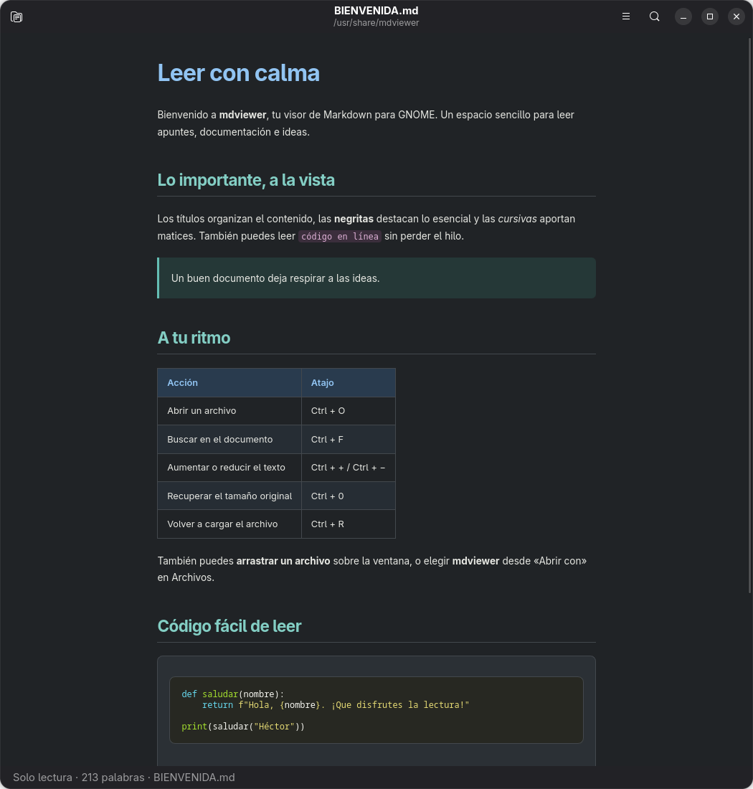
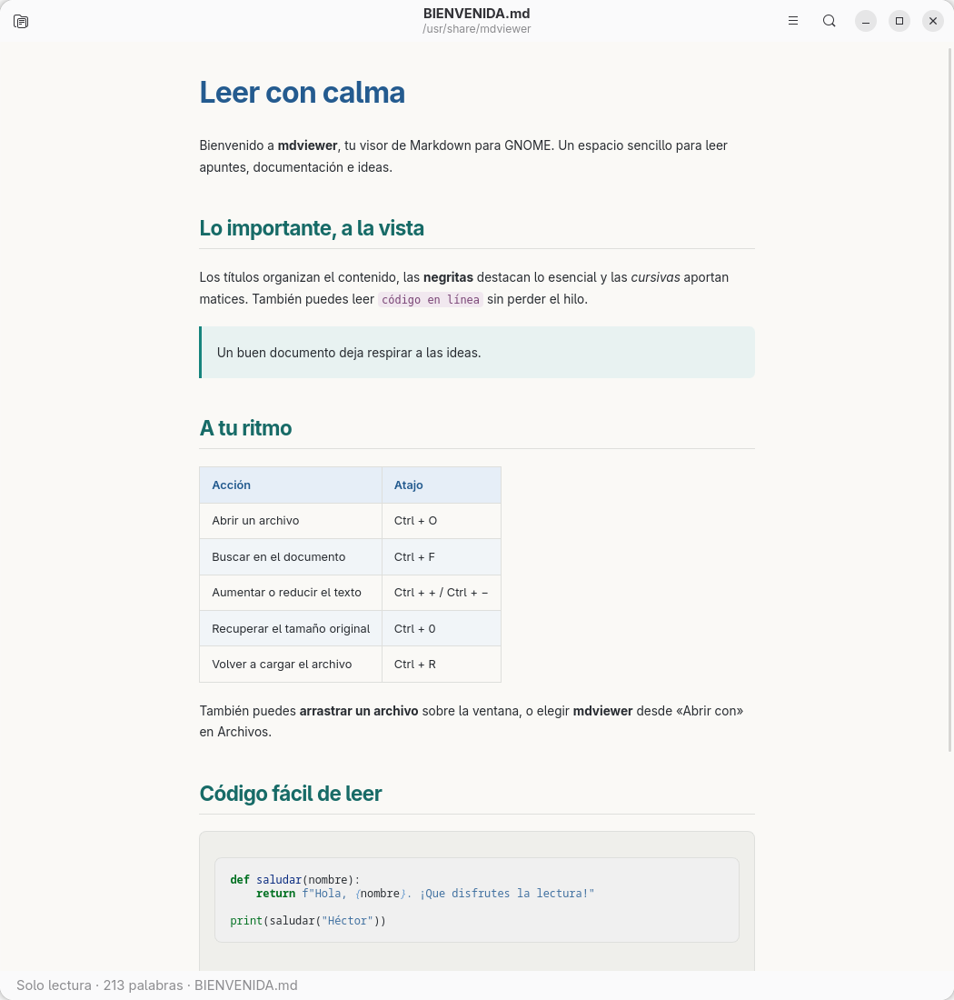

# mdviewer


Un visor Markdown con edición opcional para GNOME. Interfaz nativa con GTK 4 y libadwaita, tipografía cómoda y tema claro u oscuro según las preferencias del escritorio.

[Descargar la última versión](https://github.com/dejotaerre/mdviewer/releases/latest) · [Licencia MIT](LICENSE)

## Capturas

Capturas reales de mdviewer en GNOME, con el documento de bienvenida y zoom al 80 %.

### Tema oscuro



### Tema claro



## Funciones

- Paleta azul, turquesa y ciruela adaptada por separado a los temas claro y oscuro.
- Apertura cancelable: el selector y la lectura funcionan en procesos separados de la ventana.
- Apertura de archivos, arrastrar y soltar y varias ventanas.
- Tablas, listas, citas, tachado y código resaltado con Pygments.
- Imágenes locales y enlaces entre documentos Markdown.
- Búsqueda dentro del documento, zoom y recarga manual.
- Integración con «Abrir con» en el gestor de archivos.
- Enlaces web abiertos en el navegador del sistema.

## Paquetes para Linux

Descarga el formato adecuado desde [Releases](https://github.com/dejotaerre/mdviewer/releases/latest).

| Familia | Paquete | Versiones objetivo |
| --- | --- | --- |
| Arch Linux / CachyOS | `.pkg.tar.zst` | Sistema actualizado |
| Debian / Ubuntu | `.deb` | Debian 13, Ubuntu 24.04 |
| Fedora | `.rpm` | Fedora 44 |

Los paquetes DEB y RPM son `all` / `noarch`: contienen Python y recursos, sin binarios específicos de una CPU. Las dependencias nativas deben estar disponibles para tu arquitectura. Las pruebas de integración se realizan en contenedores x86_64.

### Debian y Ubuntu

```sh
sudo apt install ./mdviewer_0.2.0-1_all.deb
```

### Fedora

```sh
sudo dnf install ./mdviewer-0.2.0-1.fc44.noarch.rpm
```

El RPM se prepara para Fedora. No se anuncia compatibilidad con openSUSE, RHEL o derivados: los nombres y versiones de sus dependencias pueden ser diferentes. Debian 12 y Ubuntu 22.04 tampoco son objetivos de esta versión: se necesitan GTK 4.10+, libadwaita 1.4+ y WebKitGTK 6.

Todos los formatos instalan mdviewer para los usuarios del equipo, sin cambiar sus asociaciones de archivos. Son paquetes de este proyecto, no paquetes firmados ni publicados en los repositorios oficiales de las distribuciones.

### CachyOS o Arch Linux

Con `base-devel` y Git instalados:

```sh
git clone https://github.com/dejotaerre/mdviewer.git
cd mdviewer
makepkg -si
```

El paquete se instala para todos los usuarios. Las dependencias se resuelven mediante los repositorios nativos: `python`, `python-gobject`, `gtk4`, `libadwaita`, `webkitgtk-6.0`, `python-markdown-it-py` y `python-pygments`.

Para instalar un paquete ya construido:

```sh
sudo pacman -U ./mdviewer-*.pkg.tar.zst
```

Para desinstalar:

```sh
sudo pacman -R mdviewer
```

## Uso

Busca **mdviewer** en el menú de aplicaciones o ejecuta:

```sh
mdviewer documento.md
```

| Acción | Atajo |
| --- | --- |
| Abrir | Ctrl+O |
| Buscar | Ctrl+F |
| Siguiente coincidencia | Enter en el buscador |
| Acercar / alejar | Ctrl++ / Ctrl+- |
| Tamaño original | Ctrl+0 |
| Volver a cargar | Ctrl+R |
| Cerrar ventana | Ctrl+W |

Para abrir `.md`, `.MD` y `.markdown` con doble clic, cada usuario puede elegir mdviewer como aplicación predeterminada o ejecutar:

```sh
gio mime text/markdown local.mdviewer.desktop
gio mime text/x-markdown local.mdviewer.desktop
```

La instalación no impone asociaciones a otros usuarios.

## Desarrollo

Con las dependencias instaladas:

```sh
python3 mdviewer.py BIENVENIDA.md
make check
```

La aplicación busca `style.css` junto a `mdviewer.py`, por lo que funciona directamente desde el repositorio. El lanzador del paquete usa `/usr/share/mdviewer/`. La instalación soportada utiliza el prefijo `/usr`.

### Construir DEB y RPM

En Debian/Ubuntu, con `make` y `dpkg-dev` instalados:

```sh
./packaging/build-deb.sh
```

En Fedora, con `make` y `rpm-build` instalados:

```sh
./packaging/build-rpm.sh
```

Los resultados quedan en `dist/`. El constructor RPM también genera el paquete de fuentes `.src.rpm`. Las recetas están en `packaging/` y el lanzador utiliza `/usr/bin/python3` en todos los formatos.

## Ubicaciones que no responden

Desde 0.1.4, Ctrl+O abre el selector en un proceso auxiliar y la lectura del archivo se realiza en otro. Si GTK, un montaje de red o el disco tardan en responder, la ventana conserva el documento anterior y puedes seguir leyendo, buscar, cambiar el zoom o pulsar **Cancelar**.

La lectura tiene un límite de 15 segundos y el selector de 2 minutos, incluido el tiempo para elegir. Al cancelar o vencer el plazo, se solicita terminar el proceso auxiliar y se descartan sus resultados tardíos. Puedes reintentar inmediatamente. En Linux, un proceso bloqueado por el núcleo en E/S puede tardar en finalizar; mdviewer no espera por él.

Esta protección pertenece a la aplicación: no cambia montajes, conexiones, marcadores ni ajustes personales. No repara un servicio de red o del escritorio compartido que esté bloqueado. El selector aparece como ventana independiente para que el documento siga disponible.

## Alcance de esta versión

Acepta archivos locales UTF-8, con o sin BOM, hasta 10 MB. Inicia en modo lectura; permite editar el documento abierto. Las imágenes remotas no se descargan; el HTML incrustado se muestra como texto y JavaScript está desactivado. Los diagramas Mermaid se muestran como código; no hay renderizado de fórmulas matemáticas ni recarga automática.

El cambio de tema vuelve a cargar el documento y puede reiniciar la posición de lectura.

## Créditos

Creado por Dejotaerre. Construido con Python, GTK, libadwaita, WebKitGTK, markdown-it-py y Pygments.

## Edición opcional

Pulsa **Editar** o **Ctrl+E** para modificar el Markdown del archivo abierto. El mismo botón alterna con la vista previa. **Ctrl+S** guarda los cambios; el editor permite deshacer y rehacer con los atajos habituales. Al cerrar, recargar o abrir otro documento, mdviewer pregunta si quieres guardar o descartar los cambios.

El guardado conserva el BOM y los saltos de línea CRLF de archivos UTF-8, crea una copia anterior con sufijo `~` y rechaza sobrescribir un archivo que otro programa haya modificado desde su apertura. Actualmente se editan archivos existentes; no hay «Guardar como».

El guardado también utiliza un proceso separado y un plazo de 15 segundos. Si se cancela o vence el plazo, conserva el texto editado y avisa que debes comprobar el archivo: cancelar no deshace una escritura que ya se haya completado.
